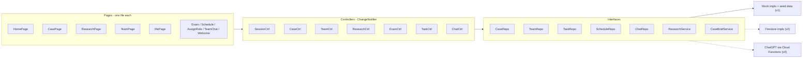

# v1 alpha — completed slices + finishing polish

**Status:** v0.1–v0.11 **Complete**. v1.0 alpha polish **In progress / finishing**.

This file is the detailed record for the web alpha. Root [`plan.md`](../../plan.md) stays the short roadmap. Do not treat completed v0.x sections below as open todos.

## Goal

Ship a working **web-only alpha** of Gavel: mock trial prep with mock AI and session-only data behind repository/service interfaces, hardened for browser use.

## Non-goals

- No Firebase, Auth, or real-time sync (see [v2-firebase-firestore.md](v2-firebase-firestore.md)).
- No iPhone/Android hardware validation as a release gate (see [v3-mobile-device-testing.md](v3-mobile-device-testing.md)).
- No live ChatGPT / OpenAI calls (see [v4-chatgpt-llm.md](v4-chatgpt-llm.md)).
- `ios/` and `android/` stay as generated Flutter folders until v2/v3 need them.

## Prerequisites

- Flutter **3.47.2** / Dart **3.13.2** (pinned in CI and `pubspec.lock`).
- Run and smoke-test in Edge or Chrome on Windows.
- Agents verify with `flutter analyze` and `flutter test` only (no browser automation).

## Alpha target: web only

- **Run locally**: `flutter run -d edge` or `flutter run -d chrome`. For phone size, use DevTools device toolbar (for example 390×844).
- **Done checklist for each completed slice**: `flutter analyze` passes, `flutter test` passes, manual smoke in Edge/Chrome, then commit and tag `v0.x`.
- **CI** (from v0.1): Ubuntu runs analyze, test, and `flutter build web`; macOS runs `flutter build ios --no-codesign`; optional `flutter build apk --debug` on Ubuntu.

## Where each part of the product description lives

- **One consolidated workspace**: Case tab (v0.5), Arguments and Examination Builder (v0.9)
- **AI-parsed case briefs**: Case brief section (v0.5); mock in v1, ChatGPT in v4
- **Timing rules**: Rules in Case (v0.5); time estimate vs limit in Examination Builder (v0.9)
- **Role assignments with task queues**: Team + Assign Role (v0.7); My tasks in Me (v0.8)
- **Research hub**: Research tab (v0.6)
- **Team chat, schedule, prep checklists**: Team chat (v0.10), Practice Schedule (v0.8), checklists in Me / Assign Role (v0.7, v0.8)
- **Unified team game plan**: readiness on Home (v0.4) and Team (v0.7)

## Architecture (v1)

Pages → `ChangeNotifier` controllers → repository/service **interfaces** → mock implementations + seed data.

Later versions swap in Firestore (v2) and ChatGPT via Cloud Functions (v4) without rewriting UI.



## Folder layout (reference)

```text
lib/
  main.dart                         # runApp(GavelApp())
  app.dart                          # GavelApp: MultiProvider + MaterialApp.router
  core/
    theme/        gavel_colors.dart, gavel_typography.dart, gavel_theme.dart, spacing.dart
    router/       app_router.dart, routes.dart
    widgets/      gavel_card.dart, stat_tile.dart, section_header.dart, status_pill.dart,
                  tag_chip.dart, progress_bar.dart, initials_avatar.dart,
                  gavel_bottom_nav.dart, app_shell.dart, empty_state.dart
    keys.dart
  data/
    models/       case_file.dart, party.dart, exhibit.dart, witness.dart, affidavit.dart,
                  case_brief.dart, timing_rule.dart, teammate.dart, trial_role.dart,
                  role_assignment.dart, task_item.dart, practice_session.dart,
                  exam_question.dart, research_message.dart, research_source.dart,
                  citation.dart, chat_message.dart, user_profile.dart
    repositories/ case_repository.dart, team_repository.dart, task_repository.dart,
                  schedule_repository.dart, chat_repository.dart
    services/     research_service.dart, case_brief_service.dart
    mock/         seed_data.dart, mock_*_repository.dart, mock_*_service.dart
  state/          *_controller.dart, teammate_matcher.dart
  features/       onboarding/, home/, case_file/, examination/, research/, team/, me/, schedule/
test/             mirrors lib/
  helpers/        pump_app.dart, fake_repositories.dart, test_clock.dart
integration_test/ app_flow_test.dart   # v1.0
test_driver/      integration_test.dart
assets/           fonts/, images/
```

## Design tokens

- **Colors**: primary maroon `#7A2335`; deep plum `#2B1820` for dark Welcome/Research; cream `#F6F1EA`; gold `#C9A24A`; status ready `#3E8E5A`, in progress `#D69A2D`, flagged `#C2453D`, info `#3B6FB6`
- **Type**: bundled Fraunces (display) and Inter (body) in `assets/fonts/`
- **Shape**: cards 16–20px radius, thin warm-grey border; raised maroon Research tab button
- **Images**: initials avatars and gradient heroes in v1; optional photos in `assets/images/`

## Test suite structure (cumulative)

- `test/core/`: theme, widgets, router
- `test/data/`: models, mock repositories and services
- `test/state/`: controllers and `TeammateMatcher`
- `test/features/<feature>/<page>_test.dart`
- `test/golden/`: visual regression (v1.0)
- `integration_test/`: full flows in Chrome for alpha
- `test/helpers/pump_app.dart`: `pumpGavelApp(tester, {overrides, initialLocation, clock})`

---

## Completed iterations (v0.1–v0.11) — do not reopen as todos

### v0.1: Foundation and theme — Complete
- `GavelApp`, `go_router`, `provider`, `intl`, bundled fonts, light/dark themes, core widgets, web title/manifest "Gavel", CI Ubuntu + macOS jobs.
- Tests: theme values and core widget rendering.

### v0.2: Navigation shell — Complete
- `StatefulShellRoute.indexedStack` with five branches; `GavelBottomNav` in `SafeArea`.
- Tests: nav items, tab switching, state kept, starts at `/home`.

### v0.3: Data models and mock repositories — Complete
- Immutable models with `copyWith`, `==`, `toMap`/`fromMap`; interfaces + State v. Harmon seed mocks.
- Tests: round-trips, seed invariants, mock CRUD.

### v0.4: Home tab — Complete
- Active case hero, stats, Ask the case, assignments, team readiness.
- Tests: readiness/countdown math, stats, Ask the case → `/research`.

### v0.5: Case tab — Complete
- Overview, Brief, Affidavits, Exhibits, Stipulations, Rules; mock `CaseBriefService`; timing rules.
- Tests: chips, brief links, counts, rules.
- Review: [docs/v0.5-review.md](../v0.5-review.md), [docs/ui-redesign.md](../ui-redesign.md).

### v0.6: Research hub — Complete
- Ask/Library, source detail, citation tracking, `MockResearchService`.
- Tests: chat flow, suggestions, save to Library, Cited in.
- Review: [docs/v0.6-review.md](../v0.6-review.md).

### v0.7: Team tab and Assign Role — Complete
- Roster, sides, open slots, `TeammateMatcher`, assign → task queue (session-only, no notification).
- Tests: matcher, filter, assignment, task completion vs role coverage.
- Review: [docs/v0.7-review.md](../v0.7-review.md).

### v0.8: Me tab and Practice Schedule — Complete
- Profile checklist, quick access, week strip, weekly planning goal (scheduled minutes).
- Tests: task checkoff, routes, week filter, goal math.
- Review: [docs/v0.8-review.md](../v0.8-review.md).

### v0.9: Examination Builder — Complete
- Opening/closing drafts; Direct/Cross scripts; timing vs shared per-side budget; mock AI suggestions.
- Tests: CRUD/reorder, stats, exhibit Cited in, over-budget warning.
- Review: [docs/v0.9-review.md](../v0.9-review.md).

### v0.10: Team chat — Complete
- Single channel, up to five linked tasks/exhibits, draft-preserving retry, idempotent message IDs.
- Tests: send, mention opens linked item.
- Review: [docs/v0.10-review.md](../v0.10-review.md).

### v0.11: Welcome / onboarding — Complete
- Dark hero, feature cards, first-launch redirect, skip once onboarded.
- Tests: first launch, enter → `/home`, skip when onboarded.

---

## v1.0: Alpha release (in progress / finishing)

Polish, hardening, and full test pass on web.

### Ordered slices

1. **Empty / loading / error states** — every list; test with a `FailingFake` repository.
2. **Accessibility and layout** — semantics labels; checks at 1.3× text scale; max content width so phone layout stays centered on wide browser windows.
3. **Golden tests** — each page at phone size (390×844), bundled fonts.
4. **Integration flow** — `integration_test/app_flow_test.dart` via  
   `flutter drive --driver=test_driver/integration_test.dart --target=integration_test/app_flow_test.dart -d chrome`  
   Flow: Welcome → Home → Research (ask + save source) → Case brief → Team (assign closing attorney) → team chat → Me (check off a task) → Schedule.
5. **Coverage and docs** — at least 80% coverage on `lib/state` and `lib/data`; update [README.md](../../README.md) with web setup, test commands, and version history.

### Done checklist (per remaining slice)

- [ ] `flutter analyze` passes
- [ ] `flutter test` passes
- [ ] Manual smoke in Edge or Chrome (developers; agents do not drive the browser)
- [ ] Commit; tag `v1.0` only when the full alpha checklist above is done

### Testing notes

- Prefer widget/unit tests that mirror `lib/`.
- Goldens and the Chrome integration drive are part of this version, not earlier slices.
- Keep mocks behind interfaces so v2/v4 swap-ins stay clean.

### Risks / ordering

- Finish interface-backed mocks and error states before Firestore (v2).
- Do not expand into Firebase, device signing, or live LLM work in this file.
